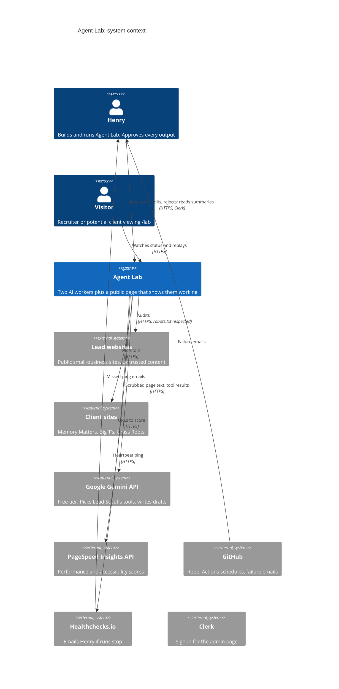
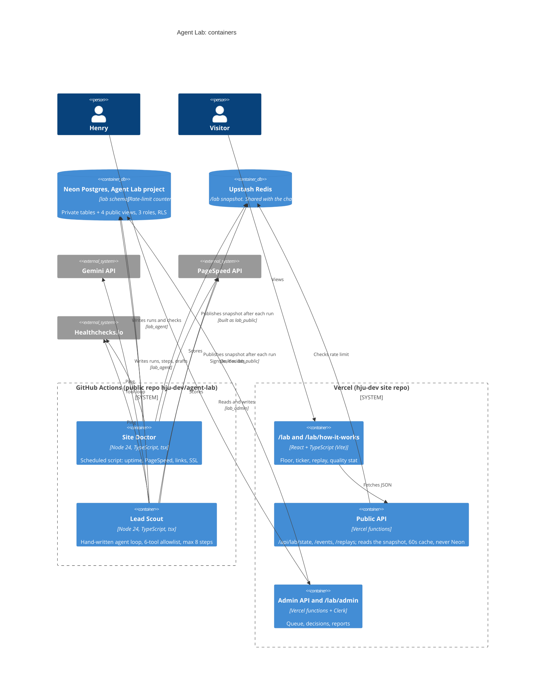

# Architecture (C4 model)

The C4 model draws a system at different zoom levels. **Level 1, context:** the system as one box, and the people and outside systems it talks to. **Level 2, containers:** the separately running pieces inside it (apps, scripts, databases). Levels 3 and 4 (components and code) are left to the phase diagrams in `docs/diagrams/`.

These use Mermaid's C4 syntax, which GitHub renders. Mermaid marks C4 support as experimental, so if a diagram doesn't render, the tables below each one say the same thing.

Decisions behind each piece are in `docs/adr/`. Threats and trust boundaries are in [THREAT_MODEL.md](THREAT_MODEL.md).

## Level 1 · System context

| Actor or system | Relationship |
| --- | --- |
| Henry | Approves every output in /lab/admin; receives failure alerts |
| Visitor | Reads /lab: status, replays, quality numbers |
| Lead websites | Audited by Lead Scout. Untrusted |
| Client sites | Monitored by Site Doctor |
| Gemini | Receives scrubbed public page text; returns tool calls and drafts |
| PageSpeed Insights | Scores pages |
| GitHub | Hosts the code and runs the schedules; emails on failure |
| Healthchecks.io | Emails if heartbeats stop |
| Clerk | Signs Henry in to admin |

## Level 2 · Containers

| Container | Technology | Talks to | As role | ADR |
| --- | --- | --- | --- | --- |
| Site Doctor | Node 24 + TS on Actions | Neon, PageSpeed, Healthchecks, (Gemini only to word findings) | `lab_agent` | 0003, 0004 |
| Lead Scout | Node 24 + TS on Actions | Neon, Gemini, PageSpeed, lead sites, Healthchecks | `lab_agent` | 0001, 0002, 0003 |
| /lab pages | React + TypeScript (Vite) | Public API | — | 0006, 0013 |
| Public API | Vercel functions | Upstash snapshot only (never Neon) | — | 0006, 0011 |
| Admin API + page | Vercel functions, Clerk | Neon | `lab_admin` | 0005, 0008 |
| Neon | Postgres, separate project | — | — | 0005 |
| Upstash | Redis, one database shared with the chatbot; Agent Lab uses `lab:` keys only | — | — | 0006, 0011 |
| Alerts | GitHub emails + Healthchecks | Henry | — | 0007 |

Studio (phases 11–14) is not a container of Agent Lab: it runs locally in Claude Code on Henry's computer (ADR-0010) and only writes a public log line to /lab in Phase 14.
