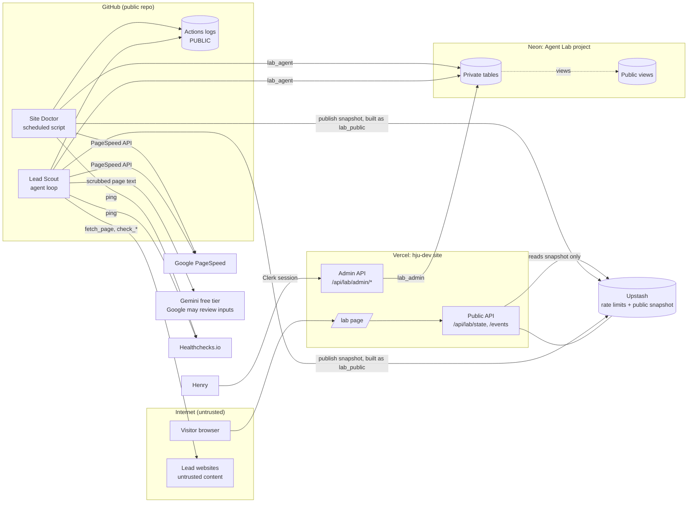

# Threat model

**What this is:** a list of the ways Agent Lab could be attacked or could leak data, each traced to the safeguard that stops it. Every safeguard in the build journal's register should trace back to at least one threat here. A threat with no safeguard is flagged **UNMITIGATED** and needs a decision from Henry: fix it, or accept the risk in writing.

**Method:** a data-flow diagram, then STRIDE per element. STRIDE is a checklist of six kinds of threat: **S**poofing (pretending to be someone), **T**ampering (changing data), **R**epudiation (denying you did something), **I**nformation disclosure (leaks), **D**enial of service (making it unavailable or too expensive), **E**levation of privilege (getting more access than allowed). Each threat is mapped to the [OWASP Top 10 for LLM Applications 2025](https://genai.owasp.org/llm-top-10/) where it involves the model, and to an [OWASP ASVS 5.0](https://owasp.org/asvs) chapter topic for web-app controls. Exact ASVS requirement IDs get added in Phase 3 (see [SOURCES.md](SOURCES.md#security-standards)).

**Review:** at each stage gate, and whenever a new external service or data flow is added.

## Data-flow diagram

**Trust boundaries** (where data crosses from one level of trust to another):

| ID | Boundary | Why it matters |
| --- | --- | --- |
| TB1 | Internet → Vercel | Anyone can call the public API |
| TB2 | Lead websites → Lead Scout | Page text is written by strangers and may contain instructions |
| TB3 | Lead Scout → Gemini free tier | Google may use and human-review free-tier inputs |
| TB4 | Private tables → public views | The only path from private data to the public |
| TB5 | Runner → public Actions logs | Anything printed is public forever |
| TB6 | Henry → Admin API | The only way to approve anything |

## Threats

Status: **Planned** (in the plan, not built yet), **Built** (code and test exist), **UNMITIGATED** (no safeguard yet), **Accepted** (Henry has decided to live with it, with a reason).

### Model and agent (Lead Scout)

| ID | STRIDE | Threat | OWASP | Safeguard | Status |
| --- | --- | --- | --- | --- | --- |
| T-L1 | T, E | Hidden text on a lead's site tells the model to call other tools, fetch other URLs or change the pitch | LLM01 Prompt Injection, LLM06 Excessive Agency | S4 (strip, cap, wrap as data), tool allowlist, S5 (URL rules), S34 (output only to the queue), injection site in the eval gate (S35) | Planned |
| T-L2 | E | Model asks `fetch_page` to read an internal address such as cloud metadata at 169.254.169.254 | LLM06; ASVS: input validation, SSRF | S5: http/https only, private and link-local ranges blocked **after DNS resolution**, max 3 redirects each re-checked, lead's own domain only | Planned |
| T-L3 | I | Emails, phone numbers or names from a lead's page are sent to Gemini's free tier, where Google may use and human-review them | LLM02 Sensitive Information Disclosure | **S25** PII scrub before every Gemini call, with a unit test | Planned (new) |
| T-L4 | T | Model invents facts about a business ("your site takes 9 seconds to load") | LLM09 Misinformation | S8 evidence check, S35 eval gate (0 fabricated facts), Henry approves every draft | Planned |
| T-L5 | E | Model output is treated as code or HTML somewhere (for example rendered with `innerHTML` in admin) | LLM05 Improper Output Handling; ASVS: output encoding | S34 output only goes to the queue, never executed. **Rendering:** admin and /lab must use `textContent` or escape all model text | **UNMITIGATED** (rendering rule not written yet) → proposed P3 |
| T-L6 | D | A loop or a huge page burns the free-tier quota or runs for hours | LLM10 Unbounded Consumption | S6 caps, S11 timeouts, S12 bounded retries | Planned |
| T-L7 | I | System prompt reveals something secret | LLM07 System Prompt Leakage | By design the prompts are public in the repo and contain no secrets or private data. Rule in CLAUDE.md | Accepted (prompts are public on purpose) |
| T-L8 | T | A compromised npm package or skill changes agent behavior | LLM03 Supply Chain | S33 lockfile + `npm ci` + Dependabot; SkillSpector scan before any skill | Planned. See T-G2 for Actions |
| T-L10 | I | A Studio skill plugin sends client images to a third-party service (img2threejs' optional img2glb plugin uses a hosted service) | LLM02, LLM03 | Install img2threejs core only, with `--dry-run` first; never the img2glb plugin with client material | Planned (Studio) |
| T-L9 | T | Golden-set labels or fixtures are wrong or tampered with, so evals pass bad prompts | LLM04 Data and Model Poisoning (closest fit) | Labels made before runs, fixtures git-ignored but hashed in the eval report | Planned |
| — | — | Vector store attacks | LLM08 Vector and Embedding Weaknesses | Not applicable: Agent Lab has no vector store | N/A |

### Public API and /lab (TB1, TB4)

| ID | STRIDE | Threat | OWASP / ASVS | Safeguard | Status |
| --- | --- | --- | --- | --- | --- |
| T-P1 | I | A private column (lead name, URL, draft) reaches the public API | ASVS: data protection, access control | S1 public views only, three roles + RLS, leak test | Planned |
| T-P2 | I | Public text contains a business name, URL or email | LLM02 | S2 public_text scanner | Planned |
| T-P3 | D | Someone floods the API to burn Neon compute or Vercel invocations | LLM10 (indirectly); ASVS: API security | Public API never touches Neon (S41); 60s CDN cache, S31 Upstash rate limit | Planned |
| T-P4 | T | Script injection into /lab through text from the database | ASVS: output encoding | Same rendering rule as T-L5 | **UNMITIGATED** → proposed P3 |
| T-P5 | I | /lab reveals Memory Matters' details beyond what they approved | ASVS: data protection | Per-site visibility setting, per-metric visibility | Planned |

### Admin (TB6)

| ID | STRIDE | Threat | OWASP / ASVS | Safeguard | Status |
| --- | --- | --- | --- | --- | --- |
| T-A1 | S, E | Someone with any Clerk account reaches admin routes | ASVS: authentication, authorization | **S29** server-side check of Clerk session **and** `ADMIN_USER_ID` on every admin route; phase 5 check (second account gets 403) | Planned |
| T-A2 | T | A forged request from another site approves a draft while Henry is signed in (CSRF) | ASVS: session management | Clerk's session handling; state-changing routes accept only POST with a JSON body and check the session token. **Confirm Clerk's CSRF behavior in its docs during Phase 5** | Planned (needs check) |
| T-A3 | D | Alerts silently stop, so a broken system goes unnoticed | — | S16 heartbeat, GitHub failure emails; Spike SP6 tests delivery | Planned |
| T-A4 | R | Henry can't tell later who approved or changed a draft, or when | ASVS: logging | Decisions table stores the action, edit size and timestamp. Single admin, so "who" is always Henry | Accepted (one user) |
| T-A5 | E | Pitches marked "ready to send" before legal sign-off | — | **S30** `pitches_enabled` flag, off by default, enforced in the database and API | Planned |
| T-A6 | — | A pitch or follow-up breaks CAN-SPAM (no address, no ad notice, ignored opt-out) | Legal | **S26** template requires postal address, ad disclosure and opt-out line on pitches **and** follow-ups; **S37** no follow-up after an opt-out or reply, at most 2 | Not active: no cold email (ADR-0012). Platform messages follow the platform's own rules |

### GitHub, secrets and logs (TB5)

| ID | STRIDE | Threat | OWASP / ASVS | Safeguard | Status |
| --- | --- | --- | --- | --- | --- |
| T-G1 | I | An API key or database URL appears in code, a log or the frontend | ASVS: configuration, secrets | **S32** secrets only in env vars and GitHub secrets, secret scanning on; S3 quiet logs | Planned |
| T-G2 | T, E | A third-party GitHub Action (e.g. `actions/setup-node@v4`) is changed upstream and steals secrets | LLM03 Supply Chain; ASVS: configuration | Pin third-party actions to a full commit SHA, not a tag | **UNMITIGATED** → proposed P1 |
| T-G3 | E | A workflow token has more permissions than it needs (e.g. write access to the repo) | ASVS: configuration | Set `permissions: contents: read` at the top of every workflow | **UNMITIGATED** → proposed P2 |
| T-G4 | I | A lead's business name or URL is printed in public Actions logs | LLM02 | S3 counts and IDs only; log review at each gate | Planned |
| T-G5 | D | Schedules quietly disabled after 60 days of no activity, or delayed at busy times | — | S16 heartbeat; **S27** schedules at odd minutes; monthly commit | Planned |
| T-G6 | T | A pull request from a stranger runs workflows with secrets | ASVS: configuration | Use only `pull_request` (not `pull_request_target`) for any PR workflow, so forks don't get secrets | Planned (rule added to CLAUDE.md) |

### Database (Neon)

| ID | STRIDE | Threat | OWASP / ASVS | Safeguard | Status |
| --- | --- | --- | --- | --- | --- |
| T-D1 | T | Testing writes junk into live data | — | S18 development branch | Planned |
| T-D2 | D | Agent Lab and the chatbot share compute hours and starve each other | — | **S28** separate Neon project | Planned (new) |
| T-D4 | D | Something keeps Neon awake (frequent cache refills, polling, monitors, open connections), the month's compute runs out mid-month and every query fails until the 1st. This happened to a client site in Oct 2026 | ASVS: availability / configuration | **S41** snapshot, **S42** weekly usage check, **S43** static monitor URLs, **S44** 402 handling; playbook audit on client builds | Planned (Oct 28) |
| T-D3 | T | A bad migration damages data and there's no recovery beyond the free plan's 6-hour restore window | ASVS: data protection | S21 migrations only; take a `pg_dump` before each migration on production | Accepted with that habit |

## Unmitigated threats, with proposed fixes

These aren't new features; they're configuration rules that close gaps. Henry decides yes or no for each.

| # | Closes | Proposed rule | Cost |
| --- | --- | --- | --- |
| P1 | T-G2 | Pin every third-party action to a full commit SHA, with the version in a comment. Dependabot can update SHAs | Minutes per workflow |
| P2 | T-G3 | `permissions: contents: read` at the top of every workflow | One line each |
| P3 | T-L5, T-P4 | Model and database text is only ever inserted with `textContent` or escaped. One Vitest test renders a string containing `<script>` and checks it shows as text | One helper and one test |

Everything not listed here has at least one planned safeguard. Each safeguard is in the build journal's register with its threat ID.
