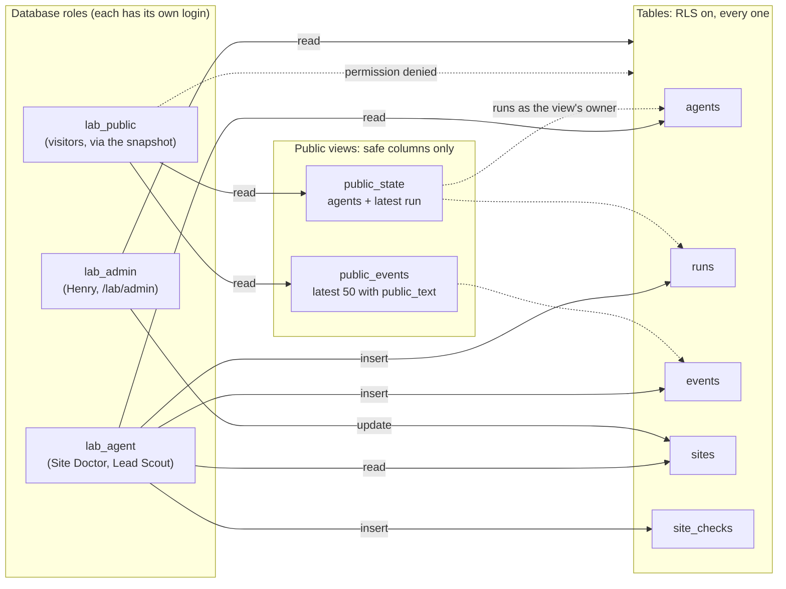

# Phase 1: database core

Who can reach what in the `lab` schema after migrations 001 and 002. Solid arrows are allowed; the dotted arrow is refused.

How it's proved: `tests/db/roles.test.ts` connects as `lab_public`, lists every table in `lab` and checks that each one has RLS on and refuses it, and that both views answer. CI runs it on a throwaway Postgres 18.6 for every pull request; Henry ran it once on the Neon dev branch (4 Nov 2026).

Sites are added by `scripts/seed-sites.ts` from the git-ignored `private/sites.json`, so client names never enter the repo.
